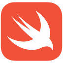

# Teoman Arif Akman

I build native iOS and macOS products and software systems.

Fourth-year Management Information Systems student in Ankara, Türkiye, exploring AI and machine learning.

## Shipped

### RenewExit

A completely free, privacy-conscious iPhone app for manually tracking subscriptions and free trials.

Local-first storage. No account required. Available on the App Store; production source remains private.

[App Store](https://apps.apple.com/tr/app/renewexit/id6783497676?l=tr) · [Public showcase](https://github.com/teomanakmn/renewexit-app)

## Public Engineering

### TechDesk

A Vue + Supabase IT help desk for ticket resolution and equipment tracking.

Versioned backend, database-enforced authorization, and server-side account management. Automated tests and isolated staging validation with synthetic data.

[Explore the source and engineering notes](https://github.com/teomanakmn/techdesk)

## In Development

**Mavioa** — A productivity product exploring progress-based access to intentional screen time.

*“Earn your time through progress.”*

**Maclet** — A native macOS productivity hub with Finder integration for small file and workflow actions.

## Technologies

  <strong>Native</strong> 
  &nbsp;Swift / SwiftUI

  <strong>Web &amp; Data</strong> 
  &nbsp;JavaScript ·
  &nbsp;Vue 
  &nbsp;Supabase ·
  &nbsp;PostgreSQL

  <strong>Supporting</strong> 
  &nbsp;Python ·
  &nbsp;Git ·
  &nbsp;C#

## Elsewhere

[LinkedIn](https://www.linkedin.com/in/teoman-arif-akman-003a83283/) · [Medium](https://medium.com/@teomanarifakman)
